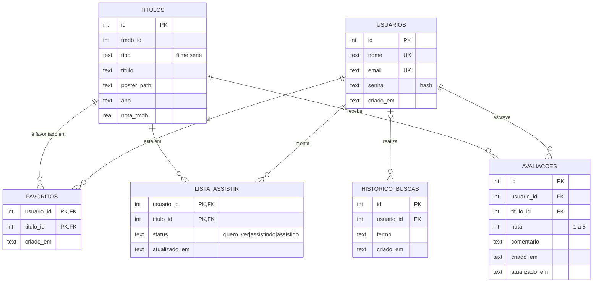

# Banco de Dados — TelaCheia

**SGBD:** SQLite (arquivo `usuarios.db`, criado automaticamente ao iniciar o `app.py`)
**Esquema:** `schema.sql` · **Acesso:** `database.py`

## Diagrama Entidade-Relacionamento

## Dicionário de dados (resumo)

| Tabela | Função | Regras principais |
|---|---|---|
| `usuarios` | Contas do site | `nome` único; `email` único; senha guardada como hash |
| `titulos` | Cache dos filmes/séries do TMDB | `(tmdb_id, tipo)` único |
| `favoritos` | Títulos favoritados | PK composta `(usuario_id, titulo_id)` |
| `lista_assistir` | Quero ver / assistindo / assistido | `status` restrito por `CHECK` |
| `avaliacoes` | Nota (1–5) + comentário | 1 avaliação por usuário/título; `CHECK (nota BETWEEN 1 AND 5)` |
| `historico_buscas` | Termos pesquisados | `usuario_id` pode ser nulo (visitante) |

## Decisões de projeto

- **Chaves estrangeiras com `ON DELETE CASCADE`:** apagar um usuário ou título remove os registros dependentes (`historico_buscas` usa `SET NULL`).
- **Segurança:** senhas com hash salgado (`werkzeug.security`); contas antigas em SHA-256 são convertidas no primeiro login; todas as consultas são parametrizadas (`?`).
- **Migração automática:** `init_db()` atualiza bancos criados pela versão anterior sem perder usuários.
- **Por que `titulos`:** as telas "Meus favoritos" e "Minha lista" são montadas só com o banco, sem chamar a API do TMDB para cada item.
